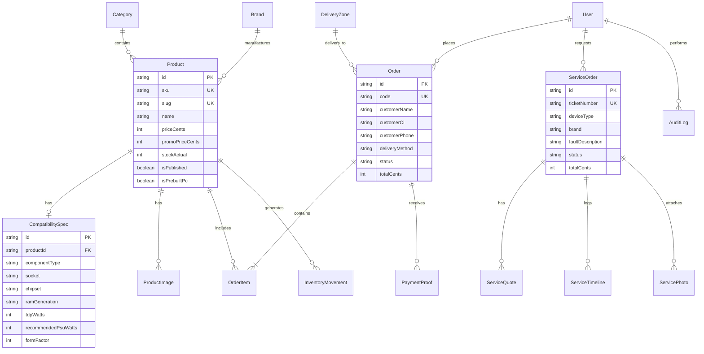

# Descripción Técnica y Arquitectónica del Sistema CLICK-TECH

> **ClickTech — Empresa de Tecnología y Servicios Digitales (Potosí, Bolivia)**  
> Documento técnico exhaustivo sobre la arquitectura, pila tecnológica, módulos funcionales, modelo de datos y protocolos operativos de la plataforma.

---

## 1. Visión General del Sistema

**CLICK-TECH** es una plataforma web integral de comercio electrónico de hardware de alto rendimiento, configuración asistida de computadoras a medida, gestión de servicio técnico con trazabilidad pública y logística geolocalizada, diseñada específicamente para el mercado de Potosí y con alcance a nivel nacional en Bolivia.

### Objetivos Clave
1. **Transparencia Comercial:** Publicación de precios en moneda nacional (**Bolivianos, Bs**), stock físico verificado en tiempo real (descontando reservas activas) y especificaciones técnicas rigurosas.
2. **Cero Incompatibilidades en Ensamblaje:** Asesoramiento automatizado y validación física/eléctrica de componentes antes de la compra para evitar errores de montaje.
3. **Servicio Técnico Cercano y Bonificado:** Cobertura técnica a domicilio en Potosí con Google Maps, garantizando **atención 100% gratuita (Bs 0)** a los clientes que hayan adquirido su equipo en ClickTech, y tarifas de traslado transparentes para clientes externos.
4. **Seguridad y Prevención Antifraude:** Protocolo estricto de identificación (Cédula de Identidad CI/NIT), verificación telefónica y despacho con precinto numerado para envíos interdepartamentales.
5. **Atención Inmediata:** Canalización fluida y directa hacia WhatsApp oficial (**+591 67605477**) y asistencia en vivo mediante un chatbot flotante gamer-tech.

---

## 2. Pila Tecnológica Detallada (Tech Stack)

```
┌────────────────────────────────────────────────────────────────────────┐
│                        CAPA DE PRESENTACIÓN                            │
│   Next.js 16 (App Router) + React 19 + TypeScript 5 + Tailwind CSS v4  │
│   Lucide Icons · Glassmorphism Gamer Neón · Responsive 360px a 1720px  │
└──────────────────────────────────┬─────────────────────────────────────┘
                                   │
┌──────────────────────────────────▼─────────────────────────────────────┐
│                     CAPA DE DOMINIO Y NEGOCIO                          │
│   Reglas de Compatibilidad Hardware · Motor de Inventario & Reservas   │
│   Flujo de Servicio Técnico · Cálculo de Tarifas Logísticas Potosí     │
└──────────────────────────────────┬─────────────────────────────────────┘
                                   │
┌──────────────────────────────────▼─────────────────────────────────────┐
│                      CAPA DE DATOS Y BACKEND                           │
│   Next.js API Route Handlers · Prisma ORM v6 · PostgreSQL 18           │
│   Transacciones ACID · Control de Acceso RBAC (Admin, Operador, User)   │
└──────────────────────────────────┬─────────────────────────────────────┘
                                   │
┌──────────────────────────────────▼─────────────────────────────────────┐
│                 SERVICIOS EXTERNOS E INTEGRACIONES                     │
│   Google Maps Embed API · WhatsApp Business Direct API · FFmpeg WebP   │
└────────────────────────────────────────────────────────────────────────┘
```

### 2.1. Frontend y Experiencia de Usuario (UI/UX)
* **Next.js 16.4 (App Router):** Utiliza la arquitectura híbrida de Server Components (RSC) para un renderizado inicial ultra veloz, óptimo SEO y consumo mínimo de JavaScript en el cliente, combinándolo con Client Components (`use client`) únicamente en componentes interactivos complejos (configurador de PC, calculador de mapas, chatbot, carrito).
* **React 19:** Aprovecha las últimas optimizaciones de concurrencia y hooks de estado sin dependencias pesadas de terceros.
* **TypeScript 5.x:** Tipado estricto end-to-end en componentes, props, eventos, modelos de Prisma y payloads de API.
* **Tailwind CSS v4 & PostCSS:** Sistema de diseño basado en variables CSS personalizadas con paleta de alto contraste para temática Gamer Dark:
  * Color de fondo chasis: `#02040A` y superficie `#0B1120`.
  * Acentos Neón: Cian Eléctrico (`#00E5FF`) y Púrpura Futurista (`#7C3AED`).
  * Contenedor maestro responsivo `.ct-container` (anchura fluida de hasta `1720px` sin márgenes muertos laterales).
  * Cuadrícula adaptable de 5 columnas en monitores panorámicos (`2xl:grid-cols-5`) y ajuste seguro en pantallas móviles de 360px sin desbordamiento horizontal.
* **Lucide React:** Iconografía técnica vectorial ligera y consistente en toda la plataforma.

### 2.2. Backend, Lógica de Negocio y APIs
* **Next.js API Route Handlers:** Endpoints RESTful estructurados bajo `src/app/api/...`:
  * `/api/products`: Filtrado y búsqueda avanzada con paginación.
  * `/api/cart`: Carrito de compras con sincronización de inventario.
  * `/api/pc-builder`: Evaluación en servidor de compatibilidad integral de hardware.
  * `/api/orders`: Creación idempotente de pedidos con control de stock y cálculo de fletes.
  * `/api/services`: Solicitudes de servicio técnico, órdenes de trabajo y cotizaciones.
  * `/api/auth`: Registro, inicio de sesión seguro y recuperación de credenciales.
  * `/api/admin/...`: Operaciones privilegiadas para administración, inventario, reportes financieros y gestión de taller.
* **Capa de Dominio Desacoplada (`src/lib/domain/`):**
  * `compatibility.ts`: Reglas matemáticas y lógicas de compatibilidad entre CPUs, placas madre, memorias RAM, GPUs, disipadores, fuentes de poder y gabinetes.
  * `inventory-orders.ts`: Algoritmos de reserva atómica de stock, expiración de reservas impagas y estados de pago.
  * `money.ts`: Manejo de divisas en centavos enteros para evitar errores de punto flotante en cálculos de Bolivianos (`Bs`).
  * `service-orders.ts` & `service-rules.ts`: Máquina de estados para el ciclo de vida de los servicios técnicos.

### 2.3. Base de Datos y Persistencia
* **PostgreSQL 18:** Motor de base de datos relacional de nivel empresarial con soporte nativo de transacciones ACID, integridad referencial y alto rendimiento en consultas estructuradas.
* **Prisma ORM v6:** Mapeo objeto-relacional tipado con migraciones declarativas (`prisma/migrations`), cliente autogenerado con soporte de esquemas relacionales complejos y ejecución segura frente a inyecciones SQL.

### 2.4. Calidad, Testing y Automatización (QA)
* **Playwright:** Suite de pruebas End-to-End en navegador real (Chromium) ejecutadas de forma automatizada sobre resoluciones móviles (360×800) y de escritorio (1440×900), validando flujos críticos de compra, visualización de mapas y chatbot.
* **Vitest:** Motor de pruebas unitarias y de integración de alto rendimiento para validar las reglas de negocio de compatibilidad y control de inventario.
* **ESLint & TypeScript Compiler (`tsc`):** Cumplimiento riguroso de pureza de funciones, idempotencia y estándares de código limpio sin errores de tipos.

### 2.5. Multimedia y Servicios Integrados
* **Google Maps Embed API:** Integración directa de mapas interactivos centrados en la ciudad de Potosí (`-19.5836, -65.7531`), configurados con filtro visual dark-mode y rutas geolocalizadas por coordenadas exactas.
* **WhatsApp Direct Link Protocol:** Generación dinámica de hipervínculos `https://wa.me/59167605477` con textos preformateados y codificados por URL para derivar consultas de catálogo, compatibilidad, pedidos y servicios técnicos.
* **FFmpeg:** Procesamiento por lotes y conversión de imágenes al formato ultra comprimido de última generación **WebP** (`800x800px`, calidad 85), reduciendo el peso de carga hasta un 70% comparado con JPEG tradicional.
* **HyperFrames Engine:** Pipeline de renderizado de video en HTML y Canvas para la generación automatizada de promociones de marca y visualización de héroes dinámicos.

---

## 3. Módulos Funcionales del Sistema a Detalle

### 3.1. Catálogo Inteligente y Rejilla de Productos
* **Navegación Fluida:** Vista de cuadrícula que se adapta desde 1 columna en móviles pequeños hasta 5 columnas en monitores 1080p, 1440p y 4K, eliminando espacios vacíos laterales.
* **Filtros Especializados:** Búsqueda en tiempo real por texto libre, SKU, categoría, marca, rango de precios en Bolivianos (Bs), socket de CPU (AM4, AM5, LGA1700) y generación de RAM (DDR4, DDR5).
* **Cálculo de Stock Transparente:** La disponibilidad mostrada corresponde a las existencias físicas en almacén menos las reservas temporales activas de otros clientes (`stockDisponible = existencias - reservas`).
* **Fotografía Real de Hardware:** Sustitución de imágenes genéricas por fotografías profesionales de ensambles modernos, torres gamer con iluminación RGB, placas madre de marcas líderes (ASUS, MSI, ASRock, Gigabyte), procesadores y memorias con disipador.

### 3.2. Ficha de Producto e Inspector de Compatibilidad Directa
* **Bloque «Compatibilidad Directa — ¿Con qué funciona este componente?»:**
  * **Memorias RAM (DDR4 / DDR5):** Detalla de inmediato con qué placas madre funciona (ej. memorias DDR4 con sockets AMD AM4 como ASUS A520M, MSI B550M, ASRock B450M e Intel LGA1200 / LGA1700 DDR4).
  * **Incompatibilidad Crítica Destacada:** Advierte con distintivo visual de alerta que los módulos DDR4 **no encajan físicamente** en ranuras DDR5 (placas AMD AM5 como B650 o Intel DDR5), previniendo compras erróneas.
  * **Consejos Técnicos de Taller:** Instrucciones prácticas para activar la tecnología Dual Channel (instalación en ranuras 2 y 4) y perfiles de frecuencia XMP/DOCP desde el BIOS.
  * **Recomendaciones Cruzadas con Stock Real:** Muestra tarjetas de placas madre o componentes compatibles con existencias en tienda con botón de 1 clic para añadir o revisar su ficha.
* **Acciones Directas:** Botón para añadir al carrito, botón para comparar especificaciones técnicas cara a cara y botón para **Consultar por WhatsApp (+591 67605477)**.

### 3.3. Configurador Inteligente de Computadoras («Arma tu PC»)
* **Flujo Asistido Paso a Paso:** Selección guiada de Procesador (CPU), Placa Madre, Memoria RAM, Tarjeta de Video (GPU), Almacenamiento SSD M.2/SATA, Fuente de Poder (PSU) y Gabinete.
* **Motor de Validación Automática:**
  * **Socket y Chipset:** Verifica correspondencia entre CPU y Placa Madre (ej. Ryzen 5 5600 con Placa AM4; Ryzen 5 7600 con Placa AM5).
  * **Generación de Memoria:** Si se selecciona una placa DDR4, el configurador filtra únicamente memorias DDR4.
  * **Cálculo de Consumo Eléctrico:** Suma el TDP del procesador, consumo de la tarjeta gráfica y periféricos, recomendando la potencia mínima necesaria de la fuente de poder (con margen de seguridad del 25%).
  * **Dimensiones Físicas:** Alerta si la longitud de la tarjeta gráfica sobrepasa el espacio interior del gabinete o si el disipador excede la altura permitida.
  * **Alerta de Gráficos:** Si el procesador no cuenta con gráficos integrados (ej. Ryzen 5 5600 o Core i5-12400F), exige la inclusión de una GPU dedicada antes de permitir la orden.
* **Presupuesto Dinámico:** Desglose en tiempo real del costo de cada pieza en Bolivianos (Bs) y opción de incluir o no el servicio de ensamblaje profesional y testeo de estabilidad.

### 3.4. Calculador de Rutas y Mantenimiento en Potosí (Google Maps)
* **Integración Geográfica:** Incorpora un mapa interactivo de Potosí, Bolivia, alimentado por Google Maps Embed API con estilo visual nocturno.
* **Zonificación Urbana de Potosí:**
  1. *Centro / Casco Histórico:* Plaza 10 de Noviembre, Calle Bolívar, Hoyos, Mercado Central (~1.0 km, ~10 min).
  2. *Zona Alta / San Roque / San Pedro:* Calles altas, Plaza El Minero (~2.2 km, ~15 min).
  3. *Plan 40 / San Gerardo / Villa Copacabana:* Zonas residenciales periféricas (~3.8 km, ~20 min).
  4. *Ciudad Satélite / Cantumarca:* Zonas de expansión (~5.0 km, ~25 min).
  5. *Las Delicias / San Antonio:* Salida norte (~3.5 km, ~18 min).
* **Beneficio Exclusivo ClickTech:**
  * **Clientes ClickTech (PC comprada o armada en taller):** 👉 **¡Visita técnica y diagnóstico a domicilio 100% GRATIS (Bs 0)!** Bonificación permanente como respaldo a clientes de la tienda.
  * **Clientes Generales («Cliente X»):** Se calcula una tarifa de traslado transparente de ida y vuelta (Bs 15 a Bs 35) según la zona seleccionada.
* **Acción Inmediata:** Botón destacado que abre WhatsApp con el técnico (`+591 67605477`), adjuntando en el mensaje la zona elegida, distancia calculada y el costo correspondiente.

### 3.5. Asistente Virtual Gamer-Tech (*ClickTech Assistant*)
* **Diseño e Interfaz:** Widget flotante en la esquina inferior derecha con acabado neón cian/púrpura, efecto de desenfoque *glassmorphism* y punto pulsante verde que indica estado «En línea».
* **Píldoras de Consulta Rápida:**
  * *Compatibilidad RAM DDR4 y placas A520/B550.*
  * *Mantenimiento GRATIS si compraste tu PC en ClickTech.*
  * *Envíos en Potosí y a nivel nacional.*
  * *Asesoría para armar PC según presupuesto.*
  * *Chatear directo al WhatsApp (67605477).*
* **Respuestas Contextuales Inteligentes:** Proporciona explicaciones técnicas concisas y ofrece botones con enlaces internos para abrir el configurador de PC o saltar al WhatsApp oficial con el técnico.

### 3.6. Checkout, Protocolo Antifraude y Logística Nacional
* **Seguridad y Verificación Antifraude:**
  * Campo obligatorio de **Cédula de Identidad (CI / NIT)** para el comprador y receptor.
  * Protocolo institucional de verificación telefónica antes del despacho para evitar suplantaciones de identidad.
  * Cada paquete se despacha con precinto numerado de seguridad y código de guía verificable.
* **Opciones de Entrega:**
  1. *Recojo en Taller Central ClickTech (Potosí Centro):* Costo Bs 0.
  2. *Entrega a Domicilio en Potosí:* Selección de zona urbana con costo fijado.
  3. *Envío Nacional a todo Bolivia:* Cobertura completa para los 9 departamentos:
     * La Paz (Terminal Central / El Alto).
     * Cochabamba (Terminal de Buses).
     * Santa Cruz (Terminal Bimodal / Courier).
     * Sucre / Chuquisaca (Terminal de Buses).
     * Oruro (Terminal de Buses).
     * Tarija (Terminal de Buses).
     * Potosí Provincias (Tupiza, Villazón, Uyuni, Llallagua).
     * Beni (Trinidad).
     * Pando (Cobija).
* **Modalidades de Pago Bolivianas:**
  * *Transferencia Bancaria / QR Simple:* Visualización de código QR oficial, banco, titular, cuenta y subida de captura de comprobante de pago para validación manual.
  * *Pago en Taller / Contra Entrega:* Habilitado para recojo en tienda o envíos locales verificados.

### 3.7. Gestión de Servicio Técnico y Seguimiento en Vivo
* **Recepción y Triage:** Formulario para registrar equipos con fallas (laptops, PCs de escritorio, consolas), especificando marca, modelo, número de serie, accesorios incluidos y síntomas observados.
* **Número de Ticket Único:** Generación de código rastreable (ej. `CT-SRV-2026-0042`).
* **Seguimiento Público Transparente:** Los clientes pueden ingresar su ticket en `/seguimiento` para observar la línea de tiempo de su reparación en tiempo real:
  * `RECEIVED` (Equipo recibido en taller).
  * `DIAGNOSING` (En diagnóstico técnico y pruebas).
  * `QUOTED` (Presupuesto emitido para repuestos y mano de obra).
  * `APPROVED / REJECTED` (Decisión tomada por el cliente en línea).
  * `IN_REPAIR` (En proceso de micro-soldadura, cambio de pasta térmica o montaje).
  * `TESTING` (Pruebas de estrés térmico y estabilidad de voltaje).
  * `READY` (Equipo listo para entrega o despacho a domicilio).
  * `DELIVERED` (Equipo entregado con acta de garantía).

### 3.8. Panel de Administración y Backoffice
* **Gestión de Inventario (Kardex):** Registro de entradas de mercadería, costos de adquisición, control de stock mínimo y alertas automáticas de reposición.
* **Validación de Pagos:** Bandeja de revisión de transferencias QR donde los administradores aprueban o rechazan comprobantes subidos por los clientes, liberando o cancelando las reservas de stock.
* **Mesa de Trabajo del Taller:** Los técnicos asignados actualizan diagnósticos, cargan fotos del equipo abierto y elaboran presupuestos detallados de mano de obra y repuestos.
* **Configuración del Negocio:** Edición centralizada de parámetros comerciales (número oficial de WhatsApp, dirección del taller en Potosí, horarios de atención y tarifas por zona).

---

## 4. Modelo de Datos y Esquema Relacional (Prisma ORM)



---

## 5. Medidas de Seguridad, Integridad y Auditoría

1. **Protección contra Inyecciones SQL y XSS:**
   * Uso de consultas parametrizadas generadas por Prisma ORM.
   * Sanitización de cadenas de entrada en todos los formularios de clientes y endpoints API.
2. **Control de Concurrencia y Sobreventa:**
   * Transacciones atómicas de base de datos (`prisma.$transaction`) al momento de generar órdenes. Si dos usuarios intentan comprar la última unidad al mismo segundo, el sistema garantiza que solo una orden se apruebe y la otra informe falta de existencias.
3. **Resguardo de Archivos Privados:**
   * Los comprobantes de pago bancario y fotografías de servicio técnico con datos personales se almacenan en un directorio privado protegido (`clicktech/storage/private/`) y solo se sirven mediante un endpoint autenticado (`/api/private-files/...`) con verificación de rol y propiedad.
4. **Trazabilidad Completa (Audit Logs):**
   * Registro histórico inmutable de cambios de estado en pedidos, modificaciones de stock en almacén y actualizaciones de diagnóstico en servicio técnico, guardando marca temporal, usuario responsable y dirección IP.

---

## 6. Procedimiento de Puesta en Producción

### Requisitos del Sistema
* Servidor Linux / Windows Server con **Node.js v20.x** o superior y **npm**.
* Motor **PostgreSQL 15+** (puerto predeterminado o personalizado).
* Utilidad del sistema **FFmpeg** instalada en el PATH (para optimización de imágenes y video).

### Pasos de Despliegue
```bash
# 1. Obtener el código fuente
git clone https://github.com/Alfred67605/CLICK-TECH.git
cd CLICK-TECH/clicktech

# 2. Instalar dependencias limpias
npm ci

# 3. Configurar variables de entorno (.env)
cp .env.example .env
# Ajustar DATABASE_URL, NEXTAUTH_SECRET y NEXT_PUBLIC_APP_URL

# 4. Sincronizar base de datos y sembrar catálogo
npx prisma migrate deploy
npm run prisma:seed

# 5. Compilar versión optimizada de producción
npm run build

# 6. Iniciar el servicio en segundo plano (Daemon / PM2 / Systemd)
npm run start
```

---

## 7. Canales Oficiales y Contacto

* **Nombre de la Empresa:** ClickTech Potosí
* **Línea de WhatsApp y Soporte Directo:** `+591 67605477` (67605477)
* **Ubicación:** Potosí, Bolivia
* **Repositorio de Código Fuente:** [https://github.com/Alfred67605/CLICK-TECH](https://github.com/Alfred67605/CLICK-TECH)
