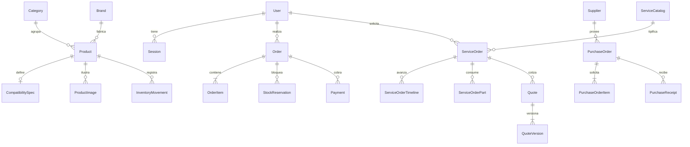

# Modelo de Datos y Reglas de Integridad — ClickTech

Motor: **PostgreSQL 18.6** administrado mediante **Prisma ORM (`prisma/schema.prisma`)**.

## 1. Diagrama Entidad–Relación Simplificado

## 2. Reglas de Integridad Implementadas

1. **Precisión monetaria exacta:** Todos los precios, costos, tarifas de envío, mano de obra y totales se almacenan como enteros en **centavos de Boliviano (BOB)** (`priceCents`, `costCents`, `totalCents`, etc.) evitando errores de coma flotante. Se formatean con `formatBs()` en `src/lib/domain/money.ts`.
2. **Snapshots históricos inmutables:** `OrderItem`, `PurchaseOrderItem`, `ServiceOrderPart` y `QuoteVersion` guardan copia de `skuSnapshot`, `productNameSnapshot`, `unitPriceCentsSnapshot`, `unitCostCentsSnapshot` y `warrantyMonthsSnapshot`, preservando pedidos históricos aunque el producto cambie de precio o se desactive (`isPublished = false`).
3. **Stock disponible y prevención de sobreventa concurrente:**
   - `disponible = stockOnHand - stockReserved`.
   - El carrito (`Cart` / `CartItem`) y una cotización pendiente (`Quote`) **no reservan inventario**.
   - Al confirmar un pedido en `createOrderTransactional`, una instrucción SQL atómica incrementa `stockReserved` únicamente cuando `("stockOnHand" - "stockReserved") >= qty`, dentro de una transacción con orden determinista de productos para evitar interbloqueos.
4. **Vencimiento y liberación idempotente:** `StockReservation` registra `expiresAt` (configurable vía `RESERVATION_TTL_MINUTES`). Al cancelar un pedido o ejecutar `releaseExpiredReservations`, la transición `ACTIVE → RELEASED/EXPIRED` usa `updateMany` condicional para no liberar unidades más de una vez.
5. **Revalidación de pago tardío e idempotencia:**
   - `Order.idempotencyKey`, `Payment.idempotencyKey`, `PurchaseReceipt.idempotencyKey` e `InventoryMovement.idempotencyKey` poseen índice `UNIQUE`.
   - Subir comprobante registra `Payment` en `PROOF_SUBMITTED` (nunca aprobado).
   - Al aprobar (`reviewPaymentTransactional`), si la reserva previa expiró (`isLateSubmission`), el sistema vuelve a ejecutar la verificación atómica `("stockOnHand" - "stockReserved") >= qty` antes de descontar existencias.
6. **Compras, servicios y devoluciones:**
   - Las órdenes de compra (`PurchaseOrder`) aumentan `stockOnHand` únicamente al registrar una `PurchaseReceipt`.
   - Cada repuesto asignado a una `ServiceOrder` crea un `InventoryMovement` de tipo `SERVICE_PART_USED` vinculado de forma única (`1:1`).
   - Las devoluciones (`ProductReturn`) solo reintegran stock tras pasar validación física (`RECEIVED_VALIDATED_RESTOCK`).
7. **Seguridad y separación de datos:**
   - `ServiceOrder.internalNotes` y `ServiceOrderTimeline.internalNote` nunca se proyectan en vistas ni endpoints públicos/cliente.
   - `Product.costCents` y márgenes de reportes se omiten en respuestas cuando el usuario tiene rol `CUSTOMER` o `TECH`.
   - Todos los tiempos se almacenan en UTC y se presentan en **`America/La_Paz`**.
